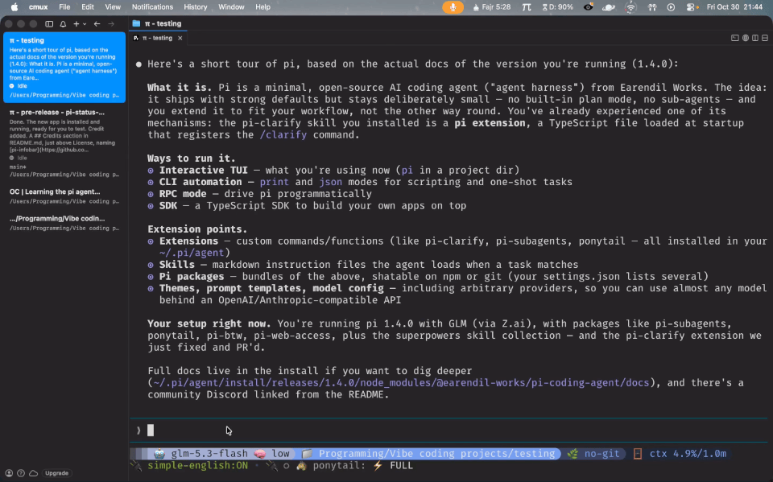

# Pi Status Bar

A small app for the macOS menu bar (the strip along the top of your screen) that shows what the
Pi coding agent is doing right now.

You start a long task in Pi, switch to your editor, and get on with your day. The menu bar keeps a
tiny **π** on screen so you can see at a glance whether Pi is working, waiting for your approval, or
finished. No window to open. No dock icon. Nothing to keep in the foreground.

```
 π        ← the menu bar item: spins while working, dots when it needs you
```



## What you get

| Where | What it shows |
|---|---|
| The menu bar | A π that spins while Pi thinks or runs a tool, a coloured dot while Pi waits for your approval, and the current step plus a timer (`Editing  1m 1s`) |
| The panel (click the π) | Your live sessions, two view toggles, two sound toggles with preview buttons, the Dashboard and Quit |
| The Dashboard (click **Dashboard…**) | Pi Stats: tokens, sessions, messages, active days, plus tabs for Languages, Models, Projects and Usage |

## Install

You need macOS 13 or newer and the Pi coding agent installed.

**The easy way: Homebrew**

```bash
brew install --cask sabuz796/tap/pi-status-bar
```

The app is signed ad-hoc, not notarized, so macOS may block the first launch. Right-click the app
and choose **Open**, or run `xattr -dr com.apple.quarantine "/Applications/Pi Status Bar.app"` once.

**The other way: build it yourself**

**1. Build the app**

```bash
cd pi-status-menubar
./build.sh
```

That produces `build/Pi Status Bar.app`. Add `--dmg` if you would rather have a disk image.

**2. Put it in your Applications folder**

```bash
cp -R "build/Pi Status Bar.app" /Applications/
```

**3. Start it once**

```bash
open "/Applications/Pi Status Bar.app"
```

The first launch copies the Pi extension into `~/.pi/agent/extensions/pi-statusbar.ts`. From then on
Pi loads it automatically, and the π appears whenever a Pi session is running.

Nothing is uploaded and nothing is downloaded. The app only reads and writes small files in your own
home folder.

## Uninstall

Installed with Homebrew? One command removes the app, the Pi extension and the saved state:

```bash
brew uninstall --cask --zap sabuz796/tap/pi-status-bar
```

Otherwise delete these three. Do the app first: it reinstalls the Pi extension on every launch,
so the extension only stays gone once the app is gone.

```bash
rm -rf "/Applications/Pi Status Bar.app"          # the app
rm ~/.pi/agent/extensions/pi-statusbar.ts          # the Pi extension
rm -rf ~/.pi/statusbar                             # saved state
```

## Using it

**The menu bar item.** The π spins gently while Pi is thinking or running a tool, and the text next
to it tells you what is happening (`Editing`, `Running command`, …) with a timer of how long the turn
has been going. When Pi asks you to confirm something, the π becomes a pulsing dot. When nothing is
running, it is a dim, still π.

**The panel.** Click the π to open it. It shows your live sessions first, each with a coloured dot
and its current state, so you can see at a glance if one of them is stuck waiting for you. Below that
are the settings:

- **Show Timer** and **Show Text**: turn the timer and the label in the menu bar on or off.
- **Permission Sound** and **Finish Sound**: two optional notification sounds, with a ▶ button next
  to each so you can hear it before you decide.
- **Dashboard…**: opens the Pi Stats dashboard.
- **Quit**: closes the app. The extension will not bring it back until a new Pi session starts.

The panel never takes the keyboard, so the app you are typing in keeps the focus. Click anywhere
outside to dismiss it.

**Clicking a session** brings its terminal to the front, so you can go answer whatever Pi is asking.

**The dashboard** reads your Pi session history and shows totals: tokens used, number of sessions and
messages, days you were active, and breakdowns by language, model and project. It reads the history
in the background and caches the result, so opening it is fast.

## How it works

Two small programs, talking through files. No server, no network, no ports.

```
  Pi (running your agent)
        │  writes one small JSON file per session
        ▼
  ~/.pi/statusbar/state.d/<sessionId>.json
        │  read every 0.4 seconds
        ▼
  Pi Status Bar.app  →  the menu bar item, the panel, the dashboard
```

1. **The Pi extension** (`extensions/pi-statusbar.ts`) listens for Pi's events (a session starting, a
   tool running, a prompt waiting for you, a turn finishing) and writes one JSON file per session.
2. **The app** (`Sources/`) reads that folder, works out which session matters most (waiting for you
   beats working beats idle) and draws the icon.

Because the state lives in files, a crash leaves the data intact, several sessions can be watched at
once, and there is nothing to install on a server or keep in sync.

The app also looks after itself: it quits when no Pi process is left, it will not start a second
copy of itself, and it cleans up session files belonging to processes that are gone.

## If something looks wrong

| Symptom | What to check |
|---|---|
| No π in the menu bar | Is Pi running? The icon only appears while a session is live. If not, the app quit on purpose after the last session ended. |
| The π does not react | The extension may not be installed. Check that `~/.pi/agent/extensions/pi-statusbar.ts` exists, then start a new Pi session. |
| The icon is missing after an app update | The app copies the extension again on every version change. Launch the app once and start a new Pi session. |
| No sound | Check the two sound toggles in the panel. A session seen for the very first time never makes a sound, so opening the app does not replay what is happening now. |
| The app will not quit | A panel or the Dashboard that is still open keeps the app alive. Close it and it exits a few seconds later. |
| The dashboard shows zero | The dashboard reads Pi's session history from `~/.pi/agent/sessions`. It needs at least one finished session to show anything. |

The app keeps a log of its own decisions in the macOS system log, if you ever need to look:

```bash
log show --last 5m --predicate 'process == "PiStatusBar"' | tail -20
```

## Working on the code

You need a Mac with Xcode command line tools (`xcode-select --install`) and Node.js for the
TypeScript parts.

**Build and install in one go**

```bash
PISTATUS_VERSION=0.0.1 ./build.sh
pkill -f PiStatusBar
rm -rf "/Applications/Pi Status Bar.app"
cp -R "build/Pi Status Bar.app" /Applications/
open "/Applications/Pi Status Bar.app"
```

**Run the checks**

```bash
swift build
swift test
node tests/extension.test.mjs
npx tsc --noEmit
```

The dashboard tests scan `tests/fixtures/sessions`, so a parser change cannot
land untested.

**Where things live**

| Path | What it is |
|---|---|
| `Package.swift` | One package: the library, the executable and the tests |
| `Sources/PiStatusBar/main.swift` | Entry point. Starts the app from the library |
| `Sources/PiStatusBarKit/App.swift` | App startup |
| `Sources/PiStatusBarKit/AppPaths.swift` | The state directory layout the app and the extension share |
| `Sources/PiStatusBarKit/StatusController.swift` | Status item, icon drawing, session polling |
| `Sources/PiStatusBarKit/StatusController+Panel.swift` | Opening and closing the panel, the toggles |
| `Sources/PiStatusBarKit/SessionRules.swift` | The rules for what counts as alive, stale or finished |
| `Sources/PiStatusBarKit/MenuPanel.swift` | The panel's rows and how they are drawn |
| `Sources/PiStatusBarKit/Sounds.swift` | The two notification sounds and when they fire |
| `Sources/PiStatusBarKit/Log.swift` | The JSONL log the app and the extension share |
| `Sources/PiStatusBarKit/Dashboard/` | The Pi Stats dashboard: scanning, storing and drawing the numbers |
| `extensions/pi-statusbar.ts` | The Pi extension that writes the session files |
| `tools/AppIcon/main.swift` | Turns `images/app-icon.svg` into an `.icns` icon |
| `tests/` | The package tests, their session fixtures and the extension state machine |
| `build.sh` | Builds the app, both chip kinds, plus the icon and an optional DMG |
| `.github/workflows/` | CI on every push, and the release job that runs on a tag |
| `LICENSE` | MIT |

**Releasing.** The version in the app comes from the newest git tag, so a release is a tag:

```bash
git tag v0.1.0 && git push origin v0.1.0
```

The Release workflow then builds the app, writes a `.dmg` and its SHA-256, and publishes them as a
GitHub prerelease. `PISTATUS_VERSION=0.1.0 ./build.sh` overrides the version by hand for a local
build. CI runs on every push to `main`: it type-checks the Swift and TypeScript and runs all three
test suites.

**House rules.** `AGENTS.md` describes how work is done in this repo.

## Contributing

Issues and pull requests are welcome. CI runs the Swift type check and the test programs in
`tests/`; run them the way `.github/workflows/ci.yml` does before opening a PR.

## Credits

The Dashboard (the **Pi Stats** panel) takes its design from
[pi-infobar](https://github.com/phun333/pi-infobar) by
[@phun333](https://github.com/phun333). Credit for the layout and the look goes there.

## License

MIT. See [LICENSE](LICENSE).
